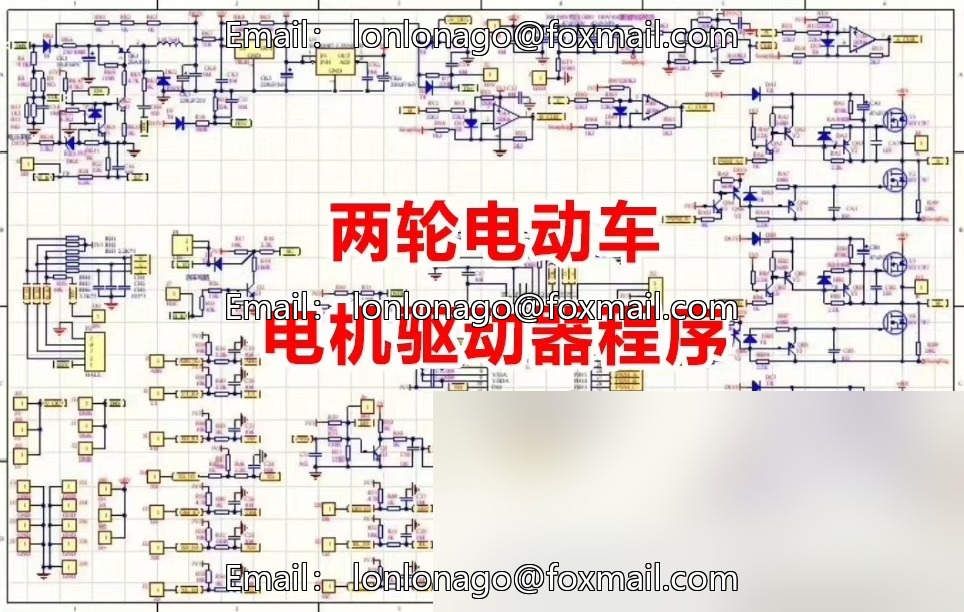
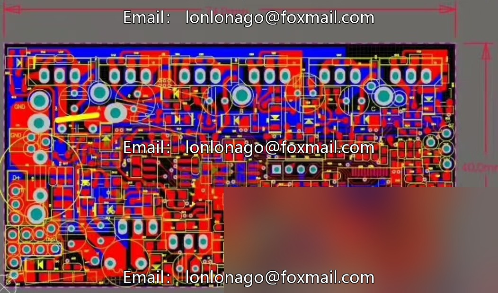
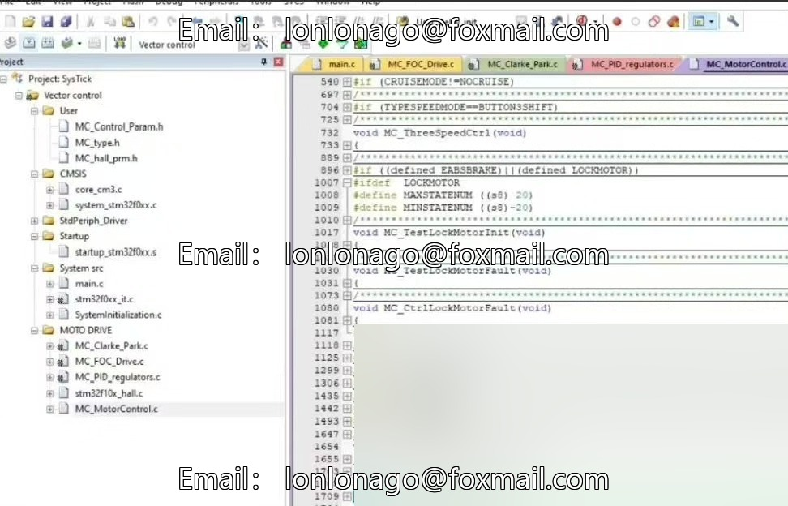
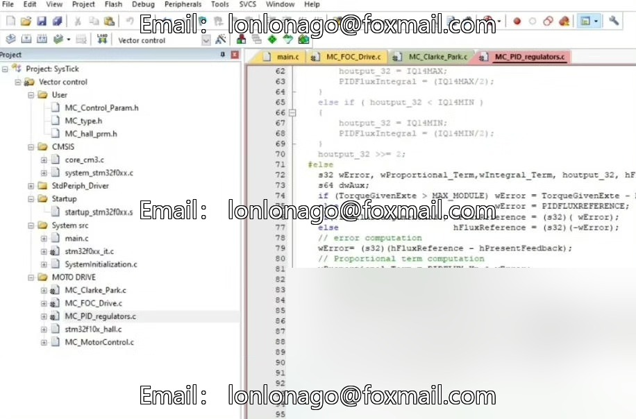
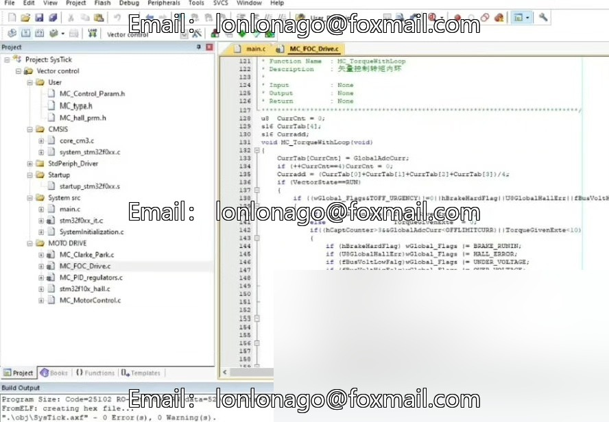
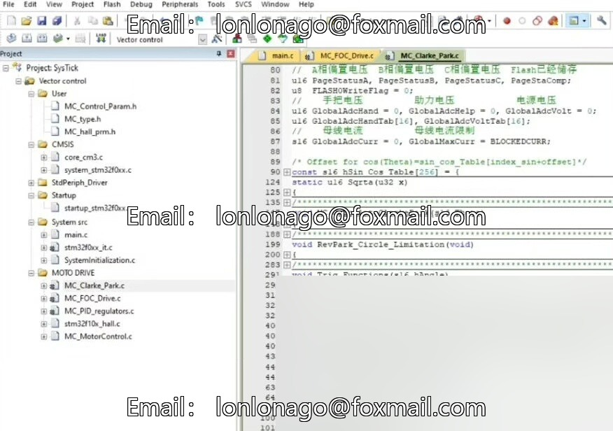

# Two-rotation electric vehicle motor driver program source code + PCB + schematic + references, using

## Body

Two-robot electric vehicle motor driver program source code + PCB + schematics + references, using FOC vector control;
Rich and comprehensive materials, including:
[1]Chips use STM32F031, domestically-replaced GD32F series, can be adapted to work;
[2]Code can be used directly, ready to be mass-produced with hardware;
[3]Voltage levels are 48V, 72V, and 96V, with the solution suitable for electric bicycles, skateboards, etc.;
[4]Algorithmic parts include Hall speed feedback and SVPWM modulation;
[5]Schematics and PCB are complete engineering files.
[6]Features are fully covered.

For example: fixed-rate cruise function, high, middle, and low three-speed, anti-roll, emergency braking, braking function, assist function, underpressure detection function, Tower King communication, anti-theft, self-learning, stall protection, etc., can be fully applied in engineering.
[7]Here are a few high-quality reference papers I organized myself!

online platform shipping, can be ordered directly

A two-wheeler electric motor driver program source, PCB, schematic and references are provided using FOC vector control, with Hall speed feedback and SVPWM modulation; voltage levels of 48V, 72V and 96V apply, applicable to electric bicycles and skateboards.

<!-- AI_ENRICHED -->

## Images

## Payment

Here is a pay link on Stripe ( https://buy.stripe.com/3cs8yP7sY87d0vu9AB ). Please contact me lonlonago@foxmail.com after funding $89, and I will send you a complete data files , thank you!

